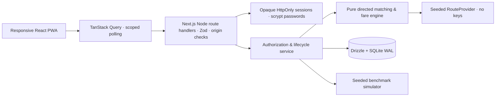

# Yatra Sync architecture

`src/domain` is independent of React and persistence. `graph.ts` provides deterministic Dijkstra and a RouteProvider interface. Directed, ordered edge overlap is a hard precondition. A common public pickup is tested against each rider's walking distance and walking readiness; destination permutations are tested for per-rider detour. Departure options stay within latest departure and earliest + max wait. Maximum capacity is four total seats and six illustrative luggage units (small=1, medium=2, large=3 per seat).

The optimizer prefilters at most 20 requests and enumerates groups of 2–4 people. It prunes monotonic hard-constraint failures, but continues through pair economics when a larger group could become feasible. Score = clamp(round(55 + 25×overlap + min(20, collective saving paise/4000) − .5×max wait minutes − max detour minutes − max walk metres/100), 0, 100). Ties are deterministic. This is a heuristic optimization, not ML or a probability. Shared fare = 6000 + 1.8 × route metres, rounded to integer paise; illustrative only.

`src/db/migrations/0001_initial.sql` is idempotent and records its version. Drizzle describes the typed application tables. Related profiles/memberships, trip route variants, group suggestions, fare quotes/allocations and simulation metrics are consolidated into user columns or versioned JSON records; group membership, sessions, reports, messages and consent/event history have normalized tables. Hubs and route edges are also seeded into SQLite. Trip indexes support community/status prefiltering. The active membership partial unique index prevents a user from simultaneously reserving two groups. It is intentionally stricter than merely banning two confirmed groups.

Each lifecycle mutation runs in a synchronous SQLite `BEGIN IMMEDIATE` transaction. An invitation evaluates fresh DB requests; its membership insert, trip reservation and events commit atomically. A stale group version is rejected. Confirmation requires all current acceptance versions. Leaving/replacement recalculates the plan, changes versions, resets approvals and notifies members. Completion releases active reservations but preserves historical group and fare access.

All API mutations use bounded Zod schemas, same-host Origin checks and process-local rate limits. The origin comparison uses the request Host header because Next's internal absolute URL may normalize the local hostname. There is no wildcard CORS. Sessions are random 32-byte tokens; only SHA-256 token digests are stored. Passwords use salted Node scrypt. Cookies are HttpOnly, SameSite=Lax, scoped to `/`, seven-day expiry, and Secure in production. Roles are read from SQLite, never from posted input. Real and synthetic discovery are isolated by community plus synthetic flag. Demo impersonation requires DEMO_MODE=true and a non-production runtime. Public exploration returns only predefined synthetic persona descriptions and public hub metadata.

Authenticated responses use no-store. The service worker caches only an offline notice and the app icon; private API/trip data is not cached. No GPS, phone numbers, card details, UPI recipients or background tracking are collected. No external network service is needed at runtime. External provider links are allowlisted HTTPS pages and are opened only on user action.

Production requires HTTPS, verified community onboarding, a real retention/deletion workflow, distributed throttling, operational moderation, abuse monitoring, backups, security review and licensed routing. SQLite is appropriate for a single local process; migrate deliberately for multi-node operation. No production-ready claim is made.

Implementation references: [Next.js installation](https://nextjs.org/docs/app/getting-started/installation) and [authentication](https://nextjs.org/docs/app/guides/authentication); version-specific bundled Next.js docs were also inspected.
