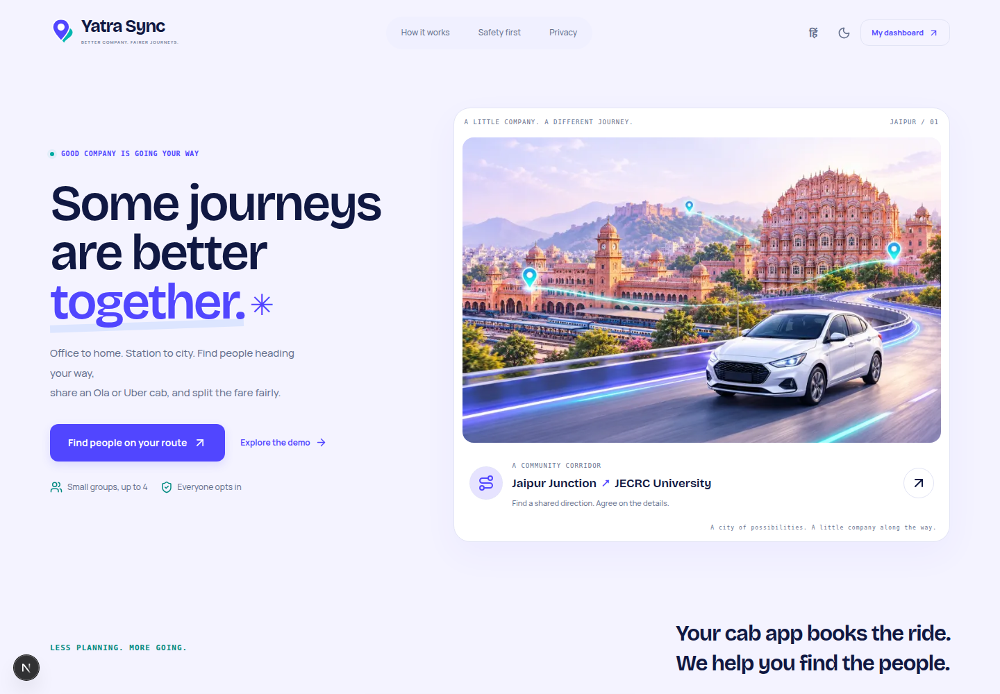

# Yatra Sync

**Find your route. Share your ride. Split your fare.**

Yatra Sync helps people find compatible co-travellers before booking an external Ola or Uber cab. Built for the moment an office commute, station transfer or airport journey feels too expensive to take alone.

## Everyday commuting

- Office, station and airport route shortcuts with a map preview and 5, 15 or 30 minute departure presets.
- Repeat and return journeys from your history, reusing comfort limits with fresh timing and quotes.
- Manual solo-versus-shared quote comparison, including extras and cases where sharing costs more.
- Compatible group discovery, individual consent, editable coordination prompts, cancellation recovery and exact-paise fare reconciliation.
- Responsive light/dark interface and an isolated three-minute judge presentation at `/demo/present`.

Current coverage uses nine illustrative Jaipur hubs. Prices are manually entered or modelled; identity, booking and payments are not provider-verified. See [product behaviour and pilot boundaries](docs/COMMUTER_PRODUCT.md) and [the presentation guide](docs/JUDGE_DEMO.md).



Canvas-inspired identity, original generated Jaipur artwork, mobile quick navigation and an interactive FairSplit planner. See [the design notes and image prompt](docs/ART_DIRECTION.md).

## Run locally

Requires Node.js 22.14+ and npm. No external API keys or accounts.

```bash
git clone https://github.com/Ruchin-Audichya/Yatra-Sync.git
cd Yatra-Sync
npm install
cp .env.example .env.local
npm run db:migrate
npm run db:seed
npm run dev -- --port 3002
```

Open **http://127.0.0.1:3002** and choose **Explore the demo**, or go directly to **/demo**. Use the printed Local URL if you choose a different port. The server binds only to the local machine. To refresh all synthetic fixtures before a demo:

```bash
npm run demo:reset
```

The SQLite file is `data/yatri-sync.sqlite` by default, overridden by DATABASE_PATH. It is ignored by Git. Reset deletes only synthetic community state and sessions; registered local accounts remain separate. Fixtures use deterministic IDs and relative future windows. A fixed-clock automated test verifies exact reset reproducibility.

## Demo personas

Use the on-screen persona buttons and the labelled switcher; no password is needed in development. Aarav starts without a trip so the creation workflow is real.

| Persona            | Purpose                                  |
| ------------------ | ---------------------------------------- |
| Aarav Sharma       | Create JECRC → Jaipur Junction request   |
| Meera Jain         | Compatible full-corridor co-traveller    |
| Kabir Singh        | Early Sitapura drop-off                  |
| Ananya Rao         | Full-corridor co-traveller / replacement |
| Demo Administrator | Studio and community report review       |

Optional password sign-in: emails are `demo-aarav@yatri.invalid`, `demo-meera@yatri.invalid`, `demo-kabir@yatri.invalid`, `demo-ananya@yatri.invalid`, `demo-admin@yatri.invalid`; password **YatriDemo!2026**. These are explicitly synthetic credentials. Demo accounts and persona impersonation are disabled when NODE_ENV=production, even if DEMO_MODE=true. Registration creates an unverified local-community adult account, never a verified campus identity.

Three-minute click path: **Aarav → Plan a journey → Continue → Continue → consent → Find my people → Invite group → individually accept as each invited persona → nominated host prepares manual external booking → self-report booking → enter actual fare → each rider accepts new shares → manually mark your own settlement → Demo studio → Run comparison → export**. See [DEMO_SCRIPT.md](DEMO_SCRIPT.md) for cancellation/recovery and a timed walkthrough.

## Verify

```bash
npm run lint
npm run typecheck
npm run test
npm run build
npx playwright install chromium
npm run test:e2e
npm run bench -- 50 42
```

Playwright starts its own local server on port 3100 and uses a separate `data/e2e.sqlite`. Port 3100 must be free; do not point this suite at a shared server. It resets only its synthetic test database. Unit/integration tests use in-memory SQLite. The CLI benchmark saves actual JSON/CSV output in `docs/evidence/`. Studio exports JSON/CSV in the browser. Tests/build results and screenshots are recorded in docs/evidence, with honest limitations.

`npm run verify` runs lint, TypeScript, unit/integration tests and production build. A production build may be launched with `npm start -- --port 3002`, after stopping the dev server, but synthetic sign-in intentionally remains disabled. Real-account production use needs HTTPS and the launch work described below; production cookies are Secure.

## What works

- Responsive light/dark UI, essential Hindi controls, installable PWA and offline notice.
- Authenticated trip create/edit/cancel/expiry, real SQLite persistence and isolated demo accounts.
- Directed graph matching, bounded multi-person search, time/walking/wait/detour/capacity/luggage/preference/block checks and explicit departure choices.
- Atomic invitations and mutual current-version consent; no duplicate active membership, automatic confirmation or overbooking.
- Group thread, notifications, block/report and permitted administrator review.
- Exact-paise proportional fare allocation, feasible solo caps, changed actual-fare review and manual settlement.
- Deterministic host, external booking handoff, self-reported progress, cancellation/replacement with fresh consent.
- Fixed-seed 25–200 request simulations, comparable baseline, delay/cancellation/outage controls and exports.

## Boundaries and launch work

All seeded Jaipur geography, road lengths, times and scenario prices are illustrative. The map works without external tiles and is not navigation. Route planning uses a common pickup hub and ordered drop-offs, rather than arbitrary multiple pickup addresses. Algorithms are deterministic optimization, not AI. Synthetic benchmarks are not evidence of actual demand, savings, safe companions or environmental impact.

No licensed routing, live train feed, email/SSO identity verification, driver tracking, payment processor or cab API is connected. All external bookings, trip completion and settlement are user-reported. No card, phone, GPS history or UPI recipient data is collected. Deletion requests are stored for manual review, not automatically executed. Full Hindi localization, recurring templates, trusted-contact sharing and Shapley allocation remain P1 work.

Before commercial deployment: validate hubs/routes and local provider permissions, implement verified institution onboarding, professional security/privacy/transport-law review, operational moderation and deletion/retention handling, backups, distributed throttling and monitored HTTPS hosting. This local product makes no legal compliance certification claim. Nothing has been deployed, pushed remotely, or submitted to a provider.

## Project guide

- `src/domain`: graph, matching, fairness and seeded simulation.
- `src/db`: Drizzle schema, SQL migration, synthetic fixtures and SQLite connection.
- `src/lib`: server authorization/lifecycle services, schemas, security and client helpers.
- `src/app`: Next App Router pages, API handlers and design system.
- `src/components`: responsive product flows.
- `tests`: algorithm, persistence/security integration and Playwright journeys.
- [PRODUCT_REVIEW.md](PRODUCT_REVIEW.md), [ARCHITECTURE.md](ARCHITECTURE.md), [FEATURE_MATRIX.md](FEATURE_MATRIX.md), [BENCHMARK_METHOD.md](BENCHMARK_METHOD.md), [IMPLEMENTATION_PLAN.md](IMPLEMENTATION_PLAN.md), [BUILD_LOG.md](BUILD_LOG.md).
